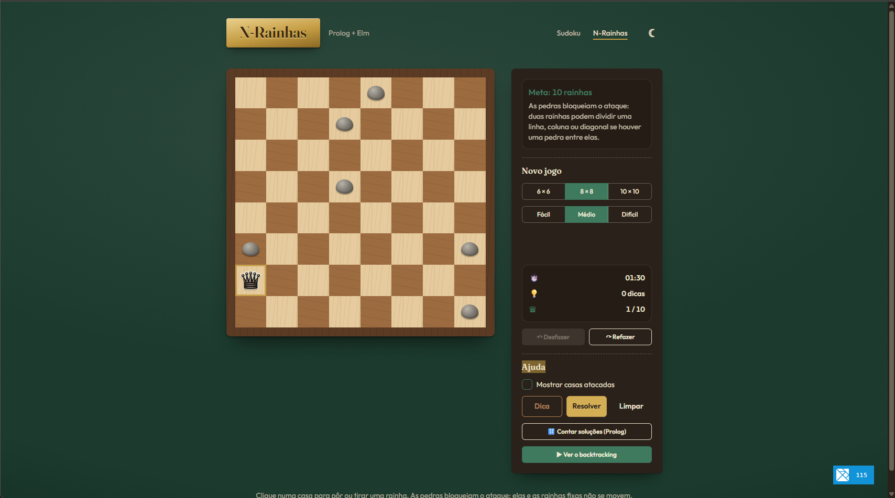

# Rainhas atrás das pedras (Prolog + Elm)

Trabalho final de Paradigmas de Programação do Grupo 12. É um site onde se
joga uma variante das **N-rainhas**: o Prolog gera, resolve e conta as
soluções dos puzzles, e o Elm desenha a interface. O Python só faz a ponte
entre os dois.



```
┌──────────────────────┐   HTTP/JSON   ┌───────────────────┐  janus  ┌──────────────────┐
│ Navegador            │ ────────────▶ │ FastAPI (Python)  │ ──────▶ │ SWI-Prolog       │
│ Elm + daisyUI (Vite) │ ◀──────────── │ backend/app/      │ ◀────── │ backend/prolog/  │
└──────────────────────┘               └───────────────────┘         └──────────────────┘
```

## O jogo: pedras bloqueiam o ataque

No clássico das N-rainhas, colocam-se N rainhas num tabuleiro N × N sem que
duas se ataquem na mesma linha, coluna ou diagonal. A nossa variante
acrescenta **pedras**:

- nenhuma rainha pode ficar numa pedra;
- a pedra **corta a linha de visão**: uma rainha só ataca até a primeira
  pedra da linha, da coluna ou da diagonal.

Por causa disso, duas rainhas podem dividir uma linha se houver uma pedra
entre elas, e o tabuleiro comporta **mais de N rainhas**. Cada puzzle traz a
sua **meta**, por exemplo 10 rainhas num 8 × 8. A meta é sempre maior que N
e o puzzle tem solução única. Algumas rainhas já vêm no lugar como pistas.

Na tela dá para:

- escolher o tamanho (6 × 6, 8 × 8 ou 10 × 10) e a dificuldade;
- clicar numa casa para pôr ou tirar uma rainha, com desfazer e refazer;
- ligar o destaque das casas ameaçadas e ver os conflitos em vermelho;
- pedir uma **dica**, mandar o Prolog **resolver** ou **contar as soluções**
  do tabuleiro atual;
- assistir à **animação do backtracking**: o passo a passo da busca do
  Prolog, com play, pausa, avanço manual e três velocidades;
- acompanhar o cronômetro, o contador de rainhas / meta e o de dicas usadas.

## O que cada parte faz

**Prolog** (`backend/prolog/queens.pl`). Modela o tabuleiro com CLP(FD): cada
casa livre é uma variável 0..1, e a regra das pedras vira restrições sobre os
trechos de linha, coluna e diagonal entre duas pedras. Os predicados
principais são:

- `solve_queens/3` resolve um tabuleiro para uma meta;
- `generate_queens/4` cria um puzzle novo com solução única e meta maior que N;
- `count_queens/4` conta as soluções até um limite;
- `hint_queens/3` indica uma casa onde vai uma rainha;
- `trace_queens/5` grava os passos da busca para a animação.

**Python** (`backend/app/`). `prolog.py` carrega os arquivos `.pl` com a
biblioteca [janus](https://www.swi-prolog.org/pldoc/man?section=janus), e
`main.py` expõe os predicados como rotas HTTP com o FastAPI e valida as
entradas. Não há lógica de jogo aqui.

**Elm** (`frontend/src/`). Segue a Arquitetura Elm (Model, Msg, update, view).

- `QueensBoard.elm` guarda o tipo do tabuleiro e as regras que precisam ser
  instantâneas: ataques com linha de visão, conflitos, casas ameaçadas e
  vitória. É puro: não faz HTTP nem HTML.
- `QueensTrace.elm` monta o tabuleiro de cada passo da animação a partir dos
  passos que o Prolog devolve. Também é puro.
- `QueensApi.elm` faz as requisições e converte JSON em valores Elm.
- `Queens.elm` cuida do estado, do histórico, do cronômetro, da animação e
  da tela.

O visual fica em `frontend/src/style.css`, com Tailwind e daisyUI. O
[Vite](https://vite.dev) serve o frontend e recompila o Elm a cada vez que
você salva um arquivo.

### E o Sudoku?

O projeto partiu do template do Sudoku do professor (`sudoku.pl`,
`Sudoku.elm`, `Api.elm`, `Main.elm`). Ele continua no repositório e
funcionando na página inicial, mas o trabalho do grupo é o N-rainhas.

## Requisitos

- [SWI-Prolog](https://www.swi-prolog.org/Download.html) 9.2 ou mais novo
  (o comando `swipl` precisa estar no PATH);
- [uv](https://docs.astral.sh/uv/) para o Python (ele instala o Python certo
  sozinho);
- [Node.js](https://nodejs.org) 20 ou mais novo, com `npm`.

O compilador do Elm é instalado pelo `npm`, dentro de `frontend/node_modules`.
Não precisa instalar nada globalmente.

No Windows, o instalador do SWI-Prolog nem sempre põe o `swipl` no PATH. Se o
`uv sync` falhar ao instalar o `janus-swi`, quase sempre é isso. Confira com
`swipl --version` e, se precisar, ajuste na sessão do PowerShell:

```powershell
$env:Path = "C:\Program Files\swipl\bin;$env:Path"
```

## Como rodar

```sh
make install    # instala as dependências (uma vez só)
make dev        # sobe backend e frontend
```

Abra **http://localhost:5173/queens.html** para jogar o N-rainhas. A
documentação interativa da API fica em http://localhost:8000/docs.

Sem `make` (por exemplo no Windows), abra dois terminais na raiz do projeto:

```sh
# terminal 1: backend
cd backend
uv sync
uv run fastapi dev app/main.py

# terminal 2: frontend
cd frontend
npm install
npm run dev
```

Os dois servidores recarregam sozinhos quando você salva um arquivo. O Vite
repassa tudo que começa com `/api` para o backend na porta 8000.

## Brincando com o Prolog direto no terminal

```
$ swipl backend/prolog/queens.pl
?- example_queens(P, G), solve_queens(P, G, S), print_queens(S).
?- generate_queens(8, medium, P, G), print_queens(P).
?- length(Row, 8), maplist(=(0), Row), length(B, 8), maplist(=(Row), B),
   count_queens(B, 8, 100, N).          % N = 92, como no clássico
```

Sem pedras e com meta N, o modelo volta a ser o N-rainhas clássico.

## Testes

```sh
make test           # tudo
make test-prolog    # Prolog (plunit)
make test-backend   # API (pytest)
make test-elm       # QueensBoard e QueensTrace em Elm (elm-test)
```

No Windows sem `make`, os testes em Elm rodam com `cd frontend` e
`npm test`.

## API do N-rainhas

Todas as rotas recebem e devolvem JSON. Um tabuleiro é uma lista de N linhas
com N inteiros cada (N de 4 a 12): `0` é casa vazia, `1` é rainha e `2` é
pedra. A meta (`goal`) é quantas rainhas o puzzle pede.

| Rota                        | Corpo enviado                          | Resposta                         |
| --------------------------- | -------------------------------------- | -------------------------------- |
| `POST /api/queens/generate` | `{"size": 8, "difficulty": "medium"}`  | `{"board": [[...]], "goal": 10}` |
| `POST /api/queens/solve`    | `{"board": [[...]], "goal": 10}`       | `{"board": [[...]]}`             |
| `POST /api/queens/hint`     | `{"board": [[...]], "goal": 10}`       | `{"row": 2, "col": 5}`           |
| `POST /api/queens/count`    | `{"board": [[...]], "goal": 10}`       | `{"count": 1}`                   |
| `POST /api/queens/trace`    | `{"board": [[...]], "goal": 10}`       | `{"steps": [...], "status": "solved"}` |

O gerador aceita tamanhos de 6 a 12 e as dificuldades `easy`, `medium` e
`hard`. Quando o tabuleiro não tem solução, `solve` e `hint` respondem com
status 422 e `{"detail": "mensagem"}`; `hint` também responde 422 quando
todas as rainhas já estão no tabuleiro. Entradas inválidas (tamanho fora da
faixa, tabuleiro não quadrado, código desconhecido) também dão 422. Cada passo
de `trace` é `[tipo, linha, coluna]`, com tipo `coloca`, `conflito` ou
`remove`.

## Problemas comuns

**`ImportError: libswipl.so.9: cannot open shared object file`** ao subir o
backend ou rodar os testes. O pacote `janus-swi` é compilado contra uma versão
específica do SWI-Prolog. Recompile o pacote ignorando o cache:

```sh
cd backend
uv sync --reinstall-package janus-swi --no-binary-package janus-swi --no-cache
```

**O 10 × 10 no Difícil demora.** A geração com solução única pode levar
alguns segundos nesse tamanho. Os tamanhos 6 × 6 e 8 × 8 ficam abaixo de 2
segundos.

## Estrutura

```
backend/
  prolog/queens.pl              N-rainhas com pedras: modelo, gerador, dica, contagem, animação
  prolog/test_queens.pl         testes plunit do N-rainhas
  prolog/sudoku.pl              Sudoku do template (página inicial)
  prolog/test_sudoku.pl         testes plunit do Sudoku
  app/prolog.py                 ponte Python → Prolog (janus)
  app/main.py                   rotas HTTP (FastAPI)
  tests/test_queens_api.py      testes da API do N-rainhas
  tests/test_api.py             testes da API do Sudoku
frontend/
  queens.html                   página do N-rainhas
  src/Queens.elm                Arquitetura Elm: estado, eventos, tela
  src/QueensBoard.elm           tipos e regras do tabuleiro (puro)
  src/QueensTrace.elm           passos da animação do backtracking (puro)
  src/QueensApi.elm             HTTP e JSON
  src/queens.js                 inicia o Elm do N-rainhas
  tests/                        elm-test (QueensBoard, casos de borda, QueensTrace)
  src/style.css                 visual completo
  index.html, src/Main.elm,
  src/Sudoku.elm, src/Api.elm   Sudoku do template
docs/captura.png                captura de tela
RELATORIO.md                    relatório de entrega
AVALIACAO.md                    critérios de avaliação
Makefile                        atalhos (install, dev, test, validar)
```

## Entrega

O relatório do grupo está em `RELATORIO.md`. Antes de entregar, confira a
forma dos documentos com o validador:

```sh
make validar
```

No Windows, se o validador quebrar com `UnicodeEncodeError`, rode antes
`$env:PYTHONIOENCODING = "utf-8"` no PowerShell.

Os critérios de avaliação estão em `AVALIACAO.md`.
