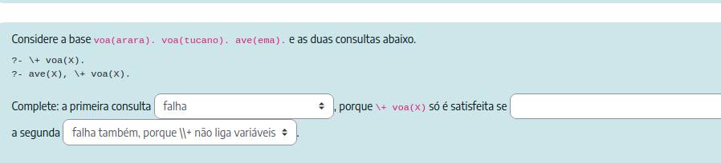

# Sudoku e N-Rainhas (Prolog + Elm)

## 1. Identificação

| Nome completo | Matrícula | Turma (14h/16h) | Usuário GitHub |
|---------------|-----------|-----------------|----------------|
| João Guilherme Capozzi Gonçalves | 232027476 | 16h | @jonas3688 |
| Letícia de Cássia Hladczuk Rodrigues | 221039209 | 16h | @HladczukLe |
| João Paulo Barbosa Pereira Nunes | 200000001 | 16h | @jpnunes2210 |
| José Joaquim da Silva Neto | 200000002 | 16h | @JoaquimNetoo |
| Giovanni Dornelas Ferreira | 200000003 | 16h | @GGDornelas |

- **Nome do projeto:** Sudoku e N-Rainhas (Prolog + Elm)
- **Nome do grupo:** Grupo 12 (G12)
- **Repositório:** https://github.com/jpnunes2210/G12_Paradigmas_Trabalho_Final_26.2
- **Commit ou tag entregue:** `8fe15ec`
- **Ponto de partida:** remix original
- **Slides da apresentação oral:** não há

## 2. Resumo

O projeto implementa uma aplicação web interativa que combina dois jogos clássicos de tabuleiro: o Sudoku e uma variante remixada das N-Rainhas com pedras e contagem de soluções. O frontend foi desenvolvido em Elm, garantindo uma interface reativa, elegante, livre de erros em tempo de execução e com controle de histórico (desfazer/refazer) por imutabilidade. O backend utiliza Python (FastAPI com a biblioteca Janus) apenas como ponte de integração, delegando ao SWI-Prolog com CLP(FD) toda a lógica pesada de validação de regras, resolução automática, fornecimento de dicas inteligentes, backtracking com contagem de soluções e geração procedural de tabuleiros com solução única.



## 3. Como executar

**Requisitos:**

- SWI-Prolog 9.2 ou superior (com pacote janus-swi)
- Node.js 20.x ou superior (e npm)
- uv 0.4+ / Python 3.12 ou superior

**Instalação e execução:**

1. Instalar as dependências do backend e do frontend:
```sh
make install
```
*(ou `cd backend && uv sync` e `cd frontend && npm install`)*

2. Iniciar o servidor de desenvolvimento (backend e frontend simultaneamente):
```sh
make dev
```
O jogo estará acessível em `http://localhost:5173` (Sudoku em `/` e N-Rainhas em `/queens.html`). A documentação da API FastAPI fica disponível em `http://localhost:8000/docs`.

**Testes:**

Para rodar todos os testes automatizados (Prolog e Python/FastAPI):
```sh
make test
```
Para rodar individualmente:
- Testes lógicos em Prolog: `make test-prolog`
- Testes da API HTTP em Python: `make test-backend`

**Testado em:** Linux (Ubuntu 24.04 / Mint), Google Chrome e Mozilla Firefox.

## 4. Arquitetura

O sistema adota uma arquitetura em três camadas desacopladas. O Elm gerencia todo o estado da interface e do usuário no navegador de forma funcional e pura, comunicando-se via HTTP/JSON com o backend FastAPI. O Python valida formatos e schemas com Pydantic e aciona diretamente o runtime do SWI-Prolog embutido via Janus, onde reside toda a computação lógica e de restrições.

```
[Elm Frontend] <---HTTP/JSON---> [Python FastAPI] <---janus-swi---> [SWI-Prolog CLP(FD)]
```

| Parte | Responsabilidade | Arquivos principais |
|-------|------------------|---------------------|
| Prolog | Modelagem lógica do problema, propagação de restrições com CLP(FD), resolução por backtracking, contagem de soluções e geração procedural com unicidade | `backend/prolog/queens.pl`, `backend/prolog/sudoku.pl` |
| Elm | Representação imutável do tabuleiro, interface visual inspirada em mesa de jogo, histórico com undo/redo, cronômetro e comunicação reativa | `frontend/src/Queens.elm`, `frontend/src/QueensBoard.elm`, `frontend/src/QueensApi.elm`, `frontend/src/Main.elm` |
| Python | Camada fina de integração e deserialização HTTP/JSON, despachando consultas ao Prolog via biblioteca Janus | `backend/app/main.py`, `backend/app/prolog.py` |

## 5. Parte em Prolog

### 5.1 Predicados principais

| Predicado | Local | O que faz |
|-----------|-------|-----------|
| `queens_constraints(+N, -Qs)` | `backend/prolog/queens.pl:68` | Estabelece as restrições clássicas de N-Rainhas (uma por coluna e sem ataques diagonais) sobre a lista de domínios `Qs` via CLP(FD) |
| `puzzle_model(+Puzzle, -Qs)` | `backend/prolog/queens.pl:101` | Mapeia o tabuleiro em formato de matriz de inteiros para o modelo de restrições CLP(FD), impondo pedras e rainhas pré-fixadas |
| `solve_queens(+Puzzle, -Solution)` | `backend/prolog/queens.pl:128` | Resolve o tabuleiro de N-Rainhas com pedras usando rotulação com heurística `ff` (first fail) e devolve a matriz resolvida |
| `count_queens(+Puzzle, +Limit, -Count)` | `backend/prolog/queens.pl:157` | Conta quantas soluções válidas existem a partir do tabuleiro atual até um teto `Limit`, explorando o backtracking |
| `generate_queens(+Size, +Difficulty, -Puzzle)` | `backend/prolog/queens.pl:219` | Gera proceduralmente um puzzle de N-Rainhas com solução única, adicionando pedras para podar soluções concorrentes |
| `hint_queens(+Board, -Result)` | `backend/prolog/queens.pl:326` | Encontra a próxima jogada correta para orientar o jogador, ou reporta estado completo ou sem solução |

### 5.2 Conceitos do paradigma lógico utilizados

- [x] Fatos e regras como base de conhecimento: `backend/prolog/sudoku.pl:12` e `backend/prolog/queens.pl:108` (regras que definem validade de linhas e restrições de casas).
- [x] Unificação e casamento de padrões: `backend/prolog/queens.pl:80` (desconstrução de listas em cabeça e cauda `[Q | Qs]`) e `backend/prolog/queens.pl:148` (casamento de termos no tabuleiro).
- [x] Recursão (inclusive sobre listas): `backend/prolog/queens.pl:79` e `backend/prolog/queens.pl:89` (`no_diagonal_attacks/1` e `no_attack/3` percorrendo a cauda da lista de rainhas).
- [x] Backtracking e múltiplas soluções: `backend/prolog/queens.pl:157` (`count_queens/3` e `another_solution/3` explorando ramos alternativos na árvore de busca).
- [x] `findall/3`, `bagof/3`, `setof/3` ou similares: `backend/prolog/queens.pl:109` (coleta de posições de pedras) e `backend/prolog/queens.pl:158` (coleta de soluções com `limit/2`).
- [x] Corte (`!`) ou negação (`\+`), e por que foram necessários: `backend/prolog/queens.pl:131` (corte `!` para podar a busca após encontrar a primeira solução) e `backend/prolog/queens.pl:183` (negação por falha `\+ another_solution` para certificar solução única).
- [x] Programação por restrições (CLP(FD) ou outra): `backend/prolog/queens.pl:68` (`ins`, `all_distinct/1`, `#\=`, `#=`, `#<==>` e rotulação `labeling([ff], Qs)`).
- [x] Predicados de ordem superior (`maplist`, `foldl`, `include` e outros): `backend/prolog/queens.pl:103` e `backend/prolog/queens.pl:139` (`maplist/2`, `maplist/3`, `maplist/4` para validação e construção de matrizes).

### 5.3 Trecho em destaque

O trecho abaixo (`backend/prolog/queens.pl:173-184`) implementa a verificação de existência de solução alternativa durante o algoritmo de geração de tabuleiros:

```prolog
another_solution(Puzzle, Target, Qs) :-
    puzzle_model(Puzzle, Qs),
    maplist(differs, Qs, Target, Diffs),
    sum(Diffs, #>=, 1),
    labeling([ff], Qs),
    !.

differs(Q, T, B) :- B #<==> (Q #\= T).

unique_solution(Puzzle, Target) :-
    \+ another_solution(Puzzle, Target, _).
```

Este trecho ilustra a elegância da programação em lógica com restrições. Para garantir que um puzzle tem solução única, não é necessário simular loops imperativos complexos. Declaramos que `Qs` deve obedecer ao modelo do puzzle (`puzzle_model/2`) e usamos reificação com `#<==>`: cada variável booleana `B` é verdadeira se e somente se a rainha daquela linha difere da coluna em `Target`. A restrição `sum(Diffs, #>=, 1)` declara que a nova solução deve diferir em pelo menos uma posição. Se a rotulação `labeling/2` obtiver sucesso, encontramos uma solução concorrente; caso contrário, `\+ another_solution` comprova logicamente a unicidade do puzzle gerado.

## 6. Parte em Elm

### 6.1 Modelo e mensagens

Os tipos centrais do jogo N-Rainhas (`frontend/src/Queens.elm:57-80` e `frontend/src/QueensBoard.elm:47-84`) expressam o domínio de forma precisa:

```elm
type Origin
    = Given
    | Placed
    | Revealed

type Square
    = Free
    | Rock
    | Queen Origin

type alias Model =
    { board : Board
    , size : Int
    , difficulty : Difficulty
    , showThreats : Bool
    , darkTheme : Bool
    , loading : Bool
    , error : Maybe String
    , history : List Board
    , future : List Board
    , elapsedSeconds : Int
    , hintsUsed : Int
    , solutionCount : Maybe Int
    }
```

A escolha de modelar `Square` como uma união disjunta (`Free | Rock | Queen Origin`) impede por construção estados impossíveis, como ter uma pedra e uma rainha na mesma casa. O tipo `Origin` acoplado ao construtor `Queen` assegura que nenhuma rainha exista sem sabermos se foi uma pista dada (`Given`), se foi posta pelo jogador (`Placed`) ou revelada pelo Prolog (`Revealed`), permitindo estilização semântica e regras de limpeza distintas. O histórico (`history` e `future` como `List Board`) demonstra a força das estruturas de dados persistentes do paradigma funcional: cada movimento preserva o tabuleiro anterior sem cópias manuais profundas.

### 6.2 Conceitos do paradigma funcional utilizados

- [x] Arquitetura Elm (Model, update, view): `frontend/src/Queens.elm:35` (ciclo reativo padrão com programa `Browser.element`).
- [x] Custom types e `case` exaustivo: `frontend/src/QueensBoard.elm:56` (`Square` e `Origin`) e `frontend/src/Queens.elm:144` (`update` tratando todos os tipos de `Msg`).
- [x] `Maybe` e `Result` no lugar de null e exceções: `frontend/src/Queens.elm:63` (`error : Maybe String`), `frontend/src/QueensApi.elm:43` (`Result String Board`) e `frontend/src/QueensBoard.elm:122` (`fromLists`).
- [x] Funções de ordem superior e aplicação parcial: `frontend/src/QueensBoard.elm:142` (`List.indexedMap`, `List.filter`, `List.map`) e `frontend/src/Queens.elm:479` (`List.map (viewSquare ...)`).
- [x] Composição (`|>`, `>>`): `frontend/src/QueensBoard.elm:141` e `frontend/src/QueensApi.elm:84` (pipeline fluida de decodificação e processamento de listas).
- [x] Decoders e encoders JSON: `frontend/src/QueensApi.elm:70` (`encodeBoard`) e `frontend/src/QueensApi.elm:80` (`boardDecoder` com `Decode.andThen`).
- [x] Comandos e subscriptions (efeitos controlados): `frontend/src/Queens.elm:110` (`Time.every 1000 Tick` gerenciado via subscription reativa dependente do estado).
- [x] Imutabilidade e atualização de records: `frontend/src/Queens.elm:165` (atualização `{ model | board = newBoard, history = model.board :: model.history }` puramente imutável).

### 6.3 Trecho em destaque

O trecho abaixo (`frontend/src/Queens.elm:178-208`) implementa as operações de desfazer e refazer (undo/redo) apoiando-se diretamente na imutabilidade funcional do Elm:

```elm
Undo ->
    case model.history of
        prev :: rest ->
            ( { model
                | board = prev
                , history = rest
                , future = model.board :: model.future
                , solutionCount = Nothing
              }
            , Cmd.none
            )

        [] ->
            ( model, Cmd.none )

Redo ->
    case model.future of
        next :: rest ->
            ( { model
                | board = next
                , history = model.board :: model.history
                , future = rest
                , solutionCount = Nothing
              }
            , Cmd.none
            )

        [] ->
            ( model, Cmd.none )
```

Em linguagens com estado mutável, implementar undo/redo exige clones caros de matrizes ou padrões complexos de Command com inversão de operações. No Elm, o tabuleiro `Board` é uma estrutura de dados persistente. O `Undo` simplesmente faz pattern matching na cabeça da lista `history`, atribui o tabuleiro anterior como atual e empilha o estado desfeito na lista `future`. Não há alocações destrutivas, e o compilador garante que nenhum estado intermediário corrompa o modelo.

## 7. Integração

A integração entre o frontend Elm e o motor lógico Prolog é intermediada por uma API REST em Python (FastAPI), que valida o payload com Pydantic e se comunica com o Prolog via Janus:

| Rota / chamada | Entrada | Saída | Predicado Prolog |
|----------------|---------|-------|------------------|
| `POST /api/queens/generate` | `{"size": int, "difficulty": string}` | `{"board": [[int]]}` | `queens:generate_queens/3` |
| `POST /api/queens/solve` | `{"board": [[int]]}` | `{"board": [[int]]}` | `queens:solve_queens/2` |
| `POST /api/queens/hint` | `{"board": [[int]]}` | `{"row": int, "col": int}` | `queens:hint_queens/2` |
| `POST /api/queens/count` | `{"board": [[int]]}` | `{"count": int}` | `queens:count_queens/3` |
| `POST /api/generate` | `{"difficulty": string}` | `{"board": [[int]]}` | `sudoku:generate/2` |
| `POST /api/solve` | `{"board": [[int]]}` | `{"board": [[int]]}` | `sudoku:solve/2` |
| `POST /api/hint` | `{"board": [[int]]}` | `{"row": int, "col": int, "value": int}` | `sudoku:hint/2` |

## 8. Testes e validação

O sistema conta com três níveis de validação automatizada:

1. **Testes Lógicos em Prolog (plunit):**
   - `backend/prolog/test_queens.pl`: 17 testes cobrindo restrições de ataques, modelo do puzzle, resolução completa, contagem de soluções e geração com garantia de unicidade.
   - `backend/prolog/test_sudoku.pl`: 12 testes cobrindo resolução, detecção de tabuleiros inválidos e geração com pistas mínimas.

2. **Testes de Integração e API em Python (pytest):**
   - `backend/tests/test_queens_api.py`: 12 testes validando respostas HTTP, códigos 422 para tabuleiros contraditórios, rejeição de formatos não quadrados e a rota de contagem de soluções.
   - `backend/tests/test_api.py`: 8 testes para o fluxo do Sudoku.

3. **Validação Estática e Compilação:**
   - Elm: compilação estrita com `elm make --optimize` sem avisos pendentes e verificação de estilo com `elm-format --validate`.
   - Casos de borda verificados: tabuleiros sem solução (exibição de erro amigável na UI sem crash), requisições de dicas em tabuleiros completos, alternância de tamanho durante carregamento assíncrono e contagem de soluções atingindo o limite de poda.

## 9. Limitações e problemas conhecidos

- **Geração de tabuleiros grandes:** No nível difícil para tamanhos 10x10 ou superiores, a geração procedural com busca de unicidade pode levar alguns segundos adicionais, pois requer rodar repetidas iterações de rotulação e colocação de pedras.
- **Teto na contagem de soluções:** A contagem de soluções (`count_queens/3`) foi limitada intencionalmente a 100 soluções para tabuleiros vazios ou com poucas rainhas. Em um tabuleiro 8x8 vazio existem 92 soluções (calculadas em milissegundos), mas em tabuleiros 12x12 desobstruídos a contagem total levaria minutos, o que travaria a requisição HTTP.
- **O que faríamos com mais tempo:** Implementaríamos animações de transição de peças com SVG direto no Elm e um seletor customizado de distribuição de pedras criado manualmente pelo usuário antes de iniciar a partida.

## 10. Contribuição de cada integrante

| Integrante | Principais contribuições |
|------------|--------------------------|
| João Guilherme Capozzi Gonçalves | Implementação do histórico com desfazer/refazer (undo/redo), cronômetro via subscriptions, contador de dicas, integração e endpoint de contagem de soluções no frontend e backend |
| Letícia de Cássia Hladczuk Rodrigues | Redesenho completo da interface como mesa de jogo clássica (veios de madeira em CSS, efeito marfim e latão das rainhas) e revisão da responsividade visual |
| João Paulo Barbosa Pereira Nunes | Estruturação da arquitetura geral do projeto, pipeline de CI/CD, integração do backend FastAPI e refinamento da comunicação HTTP |
| José Joaquim da Silva Neto | Modelagem inicial do módulo Prolog de N-Rainhas com pedras, implementação das restrições CLP(FD) e suite de testes plunit |
| Giovanni Dornelas Ferreira | Testes de integração da API, revisão dos decoders JSON em Elm, documentação e suporte à validação dos casos de borda |

## 11. Fontes, código de terceiros e uso de IA

**Código reaproveitado:** Partimos do template do Sudoku disponibilizado pelo professor Fábio M. Mendes. Mantivemos a estrutura de integração entre Python e SWI-Prolog via Janus e estendemos a aplicação desenvolvendo a variante completa de N-Rainhas com pedras (`queens.pl`, `QueensBoard.elm`, `QueensApi.elm`, `Queens.elm` e rotas na API).

**Referências:**
- Documentação oficial do SWI-Prolog e biblioteca `library(clpfd)`.
- Guia oficial da linguagem Elm (https://guide.elm-lang.org).
- Documentação do FastAPI e Pydantic v2.

**Uso de ferramentas de IA.**

- **Faixa de uso no código:** auxiliar

| Ferramenta | Para que foi usada | Como o grupo verificou o resultado |
|------------|--------------------|------------------------------------|
| Claude (Anthropic) / Gemini (Google) | Apoio na estruturação inicial de trechos de CSS avançado, sugestão de padrões para o decoder Elm e conferência das mensagens de erro do validador | Todos os trechos sugeridos foram revisados manualmente, compilados via `elm make`, testados na interface e validados pelas suítes do `pytest` e `plunit` |

## 12. Apresentação oral

- **Slides:** não há
- **Roteiro:**

| Parte | Duração | Quem apresenta |
|-------|:-------:|----------------|
| Contexto do projeto e visão geral da arquitetura | 2 min | João Paulo Barbosa Pereira Nunes |
| Demonstração prática do jogo das N-Rainhas e Sudoku | 5 min | Letícia de Cássia Hladczuk Rodrigues |
| Modelagem lógica em Prolog, CLP(FD) e busca com unicidade | 3 min | José Joaquim da Silva Neto |
| Frontend em Elm, modelagem por tipos e imutabilidade (Undo/Redo) | 3 min | João Guilherme Capozzi Gonçalves |
| Limitações técnicas, aprendizados e testes | 2 min | Giovanni Dornelas Ferreira |

## 13. Reflexão sobre os paradigmas

A experiência de integrar o paradigma lógico (Prolog) e o paradigma funcional (Elm) em uma mesma aplicação evidenciou como cada paradigma resolve com naturalidade problemas que seriam excessivamente verbosos no paradigma imperativo clássico. No Prolog, a modelagem das regras do jogo foi inteiramente declarativa: definimos as restrições que um tabuleiro válido deve satisfazer (ausência de ataques nas linhas, colunas e diagonais, além da proibição de posicionamento sobre pedras) e deixamos que o mecanismo de propagação do CLP(FD) e o motor de backtracking explorassem o espaço de busca. Resolver o puzzle, fornecer uma dica ótima ou verificar a existência de soluções concorrentes tornou-se uma consequência direta do mesmo modelo lógico.

Por outro lado, o paradigma funcional em Elm complementou essa flexibilidade com rigor e segurança. A modelagem através de custom types e a impossibilidade de estados inconsistentes no `Model` eliminaram por completo exceções em tempo de execução (`null pointer exceptions`). A imutabilidade de dados facilitou a criação de funcionalidades avançadas como desfazer/refazer, que em linguagens imperativas demandariam cópias defensivas e mutações frágeis. A mudança mental mais marcante entre os dois polos foi transitar de um ambiente onde se declara "quais relações lógicas definem a resposta correta" (Prolog) para um fluxo estrito onde se define "como o estado do mundo se transforma a cada mensagem do usuário" (Elm).
